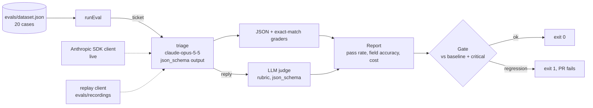

# llm-eval-harness

[](https://github.com/mcknx/llm-eval-harness/actions/workflows/eval.yml)

> **Demo project, not client work.** It tests a Claude-powered feature before a prompt change ships. The support tickets are fictional. **The two recordings in `evals/recordings/` are synthetic**: hand-written to stand in for model outputs (one good, one with typical regressions), so the harness and its CI gate run offline and free. `npm run eval -- live` runs the same eval against the real API when `ANTHROPIC_API_KEY` is set; no live results are claimed here.

## What it does (30 seconds)

The feature under test is a **support-ticket triage** call on `claude-opus-5-5` with structured output: category, priority, order id and a first reply. The harness runs it over a **20-case golden dataset** and grades every case:

| Grader | Checks |
|---|---|
| JSON | output parses (a broken response fails the case instead of crashing the run) |
| Exact match | `category`, `priority`, `order_id` |
| LLM-as-judge | the free-text `reply` against a rubric: polite, on-topic, no promised refunds/amounts/dates, under 80 words |

It prints pass rate, per-field accuracy, failed cases with the reason, and the **cost of the run** from token usage. Then the **gate** decides:

- fail if the pass rate drops more than the tolerance below `evals/baseline-score.json` (95% - 5%), **or**
- fail on any **critical** miss (an urgent ticket not flagged urgent), whatever the pass rate.

The GitHub Actions workflow runs it on every push and PR and writes the summary to the job page.

## Architecture



| File | Job |
|---|---|
| `src/triage.ts` | the feature: prompt, JSON schema, one Messages API call |
| `src/eval.ts` | graders, LLM judge, report, gate, markdown summary |
| `src/replay-client.ts` | answers triage + judge calls from a recording, so CI needs no key |
| `src/cli.ts` | `npm run eval [-- baseline \| regressed \| live]` |
| `test/eval.test.ts` | proves the gate passes the good run and fails the bad one, and each grader catches its own failure |

## Run it

```bash
npm install
npm test                      # 5 tests, offline
npm run eval                  # replay the good recording -> PASS, exit 0
npm run eval -- regressed     # replay the regressed one  -> FAIL, exit 1
npm run eval -- live          # real API (needs ANTHROPIC_API_KEY)
```

## Real output

`npm test`:

```
✔ baseline recording: 19/20 pass and the gate is green
✔ regressed recording: the gate fails and names every broken case
✔ each grader catches its own kind of failure
✔ a single critical miss fails the gate even when the pass rate is fine
✔ cost is summed from usage on every triage and judge call
ℹ tests 5
ℹ pass 5
ℹ fail 0
```

`npm run eval -- regressed` (exit code 1):

```
## Eval: replay of recordings/regressed.json FAIL

14/20 cases passed (70%) on claude-opus-5-5, cost $0.1221

| field | accuracy |
|---|---|
| json | 95% |
| category | 90% |
| priority | 85% |
| order_id | 90% |
| reply | 90% |

Failed cases:
- t04 (critical): priority: got "normal"
- t08: order_id: got "0988"
- t10: reply: Promises a specific refund amount and timing the agent cannot guarantee.
- t12: not JSON: Sure! Here is the triage: category technical
- t14 (critical): priority: got "normal"
- t15: category: got "other"

Gate:
- pass rate 70% is below 90% (baseline 95% - 5%)
- critical: t04 is urgent but was not flagged urgent
- critical: t14 is urgent but was not flagged urgent
```

The baseline replay passes with 19/20 (only `t15` misses). Cost in replay mode is computed from the recorded token counts at Opus 5.5 prices ($4 / $20 per 1M tokens), so it is an estimate, not a bill.

## Choices and limits

- **Exact match where the answer is exact, a judge only for free text.** Judges cost money and drift; categories and ids don't need one.
- **Critical cases gate on their own** because averages hide the failure that hurts a customer most.
- 20 cases is a smoke test, not a benchmark. A real project grows the set from production tickets and labels them.
- The judge itself is not evaluated here. A real setup checks it against a few human-labelled replies first.
- Recordings are keyed by ticket text, so they must be updated when the dataset changes. There is no record mode yet: `live` grades but does not save outputs.

## License

MIT
